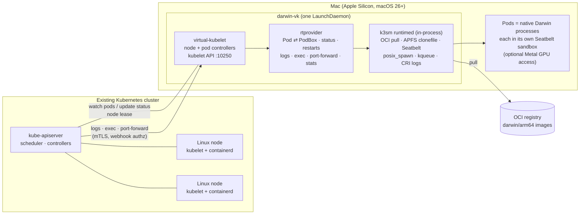

# darwin-runner-vkube

**Join a Mac to any Kubernetes cluster as a worker node, and schedule macOS workloads next to your Linux ones.**

`darwin-vk` is a [virtual-kubelet](https://github.com/virtual-kubelet/virtual-kubelet) node agent for macOS. It runs [k3sm](https://github.com/k3sm-io/k3sm)'s native runtime, [`runtimed`](https://github.com/k3sm-io/runtimed), inside the same process. Pods scheduled onto the Mac run as **native Darwin processes** confined by a per-pod Seatbelt sandbox. They can come from **OCI images** (`darwin/arm64`) and can get access to the Mac's **Metal GPU**. No Linux VM is involved.

## A heterogeneous cluster

Most clusters are all Linux. Some work only runs on macOS: Xcode builds and signing, iOS simulators, Metal/MLX inference on Apple Silicon unified memory, macOS-only tooling. `darwin-vk` lets those workloads join the cluster you already run, rather than needing a separate fleet with separate tooling:

- **One control plane, mixed OS and architecture.** Linux amd64/arm64 nodes and Apple Silicon Macs sit in the same cluster. The scheduler places pods by `kubernetes.io/os` / `kubernetes.io/arch`, so a single Deployment, Job or CI pipeline can fan out across both.
- **The same tools everywhere.** `kubectl`, Helm, GitOps, RBAC, Secrets, namespaces and quotas work the same for macOS workloads. `kubectl logs`, `exec`, `port-forward` and `top` work on Mac pods.
- **Opt-in placement.** The Mac node is tainted, so Linux workloads never land on it by accident. Linux DaemonSets (CNI, kube-proxy) stay away because of their `os=linux` selectors.
- **Apple Silicon GPU as a schedulable resource.** Pods that request `mlx.k3sm.io/gpu` get Metal access. All other pods are denied it by the sandbox.

## Architecture



| Kubernetes concept | On the Mac |
|---|---|
| Node | `kubernetes.io/os=darwin`, real CPU/memory capacity, tainted `virtual-kubelet.io/provider=darwin:NoSchedule` |
| Container image | A `darwin/arm64` OCI image pulled (with `imagePullSecrets`), digest-pinned and unpacked with APFS `clonefile`. Unsigned binaries are ad-hoc signed. Or `image: native` with an absolute host `command`. See [Images](#images). |
| Isolation | A generated default-deny Seatbelt profile per pod: the pod can write only its own data dir, the user's home is denied, and so are other pods. As root, pods also drop to a dedicated `_darwinvk` user. |
| GPU | The node advertises `mlx.k3sm.io/gpu` plus chip and memory labels. A pod that requests it gets Metal (AGX/IOSurface) access in its sandbox; other pods are denied. See [GPU pods](#gpu-pods). |
| `restartPolicy` | `Always` / `OnFailure` / `Never`, with CrashLoopBackOff (10s doubling to 5m) |
| Logs | CRI-format files; `kubectl logs` with `-f`, `--tail`, `--previous`, `--timestamps`, `--since` |
| `kubectl exec` | Re-enters the pod's sandbox and identity. TTY, stdin and exit codes are supported. |
| `kubectl port-forward` / `top` | Supported. `top` uses `proc_pid_rusage` accounting through `/metrics/resource`. |
| Volumes | `configMap`, `secret`, `emptyDir`, `downwardAPI` and `projected` (including the default service account token), kept up to date. See [Pod features](#pod-features). |
| Probes and hooks | Liveness, readiness and startup probes (exec, HTTP, TCP, gRPC); `postStart` and `preStop` hooks |
| Memory limits | Enforced; a container over its limit is `OOMKilled` |
| Node conditions | `MemoryPressure`, `DiskPressure` and `PIDPressure` from the Mac; `--system-reserved` keeps memory for macOS |
| Pod IP | The node IP by default. With `--pod-network=flannel`, each pod's own IP from the node's podCIDR, routed over the cluster's flannel network, with ClusterIP Services and cluster DNS. See [Pod networking](#pod-networking). |
| Daemon restart | Running pods are re-attached rather than restarted |

## Status

The roadmap and design notes are in [issue #1](https://github.com/changtimwu/darwin-runner-vkube/issues/1).

| Phase | | |
|---|---|---|
| v0 | ✅ | Unconfined host-process provider (`--runtime=process`) |
| P0 | ✅ | Spike: runtimed in-process, OCI pull, GPU in sandbox ([findings](spike/p0/FINDINGS.md)) |
| P1 | ✅ | runtimed-backed provider: lifecycle, restarts, logs, exec, port-forward, stats, re-attach, LaunchDaemon |
| P2 | ✅ | OCI images: `imagePullSecrets`, HTTPS and plain-HTTP registries, `ErrImagePull`/`ImagePullBackOff` with retries and events, signature policy, image GC, `mkimage` |
| P3 | ✅ | GPU advertisement (`mlx.k3sm.io/gpu` capacity and labels), GPU memory admission, Xcode toolchain opt-in |
| P4 | ✅ | Volumes, probes, lifecycle hooks, `OOMKilled`, QoS, node conditions, system reserve |
| P5 | ✅ | Linux images through the `vm` RuntimeClass; routable pod networking and cluster DNS |

## Requirements

- An Apple Silicon Mac on **macOS 26 (Tahoe) or later**
- Go 1.26+ with cgo (Xcode Command Line Tools)
- Network reachability: the Mac to the API server, and the API server to the Mac on TCP **10250** (for logs, exec and port-forward)

## Quick start

**1. Build** (fetches the pinned `k3sm-io/runtimed` and `k3sm-io/apis` checkouts into `third_party/`):

```sh
make build        # -> bin/darwin-vk and bin/k3sm-execshim (must stay side by side)
make test
```

**2. On the cluster** (admin kubeconfig):

```sh
kubectl apply -f deploy/rbac.yaml deploy/runtimeclass.yaml
./deploy/make-kubeconfig.sh            # -> darwin-vk.kubeconfig, cluster-ca.crt
```

`--client-ca` must be the CA that signs the API server's **kubelet client** certificate. On kubeadm that's the cluster CA. On k3s it's `/var/lib/rancher/k3s/server/tls/client-ca.crt`.

**3a. Run for development** (as your user; pods share your uid but stay sandboxed):

```sh
./bin/darwin-vk --kubeconfig darwin-vk.kubeconfig --client-ca cluster-ca.crt --node-ip <mac-ip>
```

**3b. Install for production** (root LaunchDaemon; pods drop to the `_darwinvk` user):

```sh
sudo deploy/install.sh darwin-vk.kubeconfig cluster-ca.crt --node-ip <mac-ip>
sudo deploy/install.sh --uninstall
```

Add `--pod-network flannel` to give pods their own IPs on a flannel cluster (see [Pod networking](#pod-networking)).

**4. Try it:**

```sh
kubectl get nodes -o wide
kubectl apply -f examples/hello.yaml
kubectl logs -f hello-mac
kubectl exec -it hello-mac -- /bin/zsh
```

To run your own image, see [Images](#images). `examples/oci-gpu.yaml` shows a GPU pod.

### k3s clusters

- Start the k3s server with `--egress-selector-mode disabled`. Otherwise the API server sends kubelet traffic through the k3s agent tunnel, which `darwin-vk` doesn't speak, and `logs`/`exec` fail with 502.
- k3s verifies kubelet serving certificates. Issue `--tls-cert`/`--tls-key` signed by `/var/lib/rancher/k3s/server/tls/server-ca.{crt,key}`, with the Mac's IP in the SAN.

## Images

Pods run `darwin/arm64` OCI images: a filesystem of Mach-O binaries, not a Linux container. `make build` also builds `bin/mkimage`, which packages executables into a single-layer image and pushes it:

```sh
GOOS=darwin GOARCH=arm64 go build -o hello ./cmd/hello
bin/mkimage -ref registry.example.com/team/hello:1 ./hello   # credentials from `docker login`
```

Each file goes in `/bin`; the first is the entrypoint, and a pod's `command` overrides it. Any registry that serves OCI images works. A multi-platform image needs a `darwin/arm64` entry.

**Registries.** Pulls use HTTPS, trusting the Mac's system roots. Loopback and private (RFC 1918) addresses use plain HTTP. Name any other plain-HTTP registry with `--insecure-registry host:port`.

**Private images.** Add `imagePullSecrets` as usual (`kubectl create secret docker-registry ...`). `darwin-vk` reads the Secret when it pulls, so a Secret created or fixed later is picked up by the next retry. Matching follows the kubelet: a key can be a host, `host:port`, `*.domain` or a path prefix, and the most specific one wins. See `examples/private-image.yaml`.

**When a pull fails**, the container waits with the kubelet's reason and the pod gets `Failed` and `BackOff` events:

| Reason | Retried |
|---|---|
| `ErrImagePull`, then `ImagePullBackOff` (registry error, auth, no `darwin/arm64` entry, signature rejected) | Yes: 10s doubling to 5m |
| `ErrImageNeverPull` (`imagePullPolicy: Never` and the image isn't on the node) | Yes |
| `InvalidImageName` | No |

**Signatures.** Before exec, binaries are checked against `--signature-policy`. The default `adhoc-ok` signs unsigned binaries ad hoc. `require-signed` needs a real signing identity and `require-notarized` needs notarization. A rejected binary shows as `ImagePullBackOff`.

**Disk.** Images are content-addressed and shared between pods. They are cloned (APFS `clonefile`) into each pod, so a copy costs almost nothing until a pod writes to it. When free space on the data volume drops under 5 GiB, unused images are removed until 10 GiB is free. The data volume's size is the node's `ephemeral-storage` capacity.

## Pod features

**Volumes.** `configMap`, `secret`, `emptyDir`, `downwardAPI` and `projected` volumes work, including `items`, `defaultMode`, `optional` and `subPath`. ConfigMap and Secret changes reach running pods within about a minute, except through `subPath`. The service account token every pod gets is minted with the TokenRequest API, bound to the pod, and renewed before it expires. A pod whose ConfigMap or Secret doesn't exist yet waits in `Pending` with `FailedMount` events and starts once it appears.

Not supported, and rejected with `AdmissionRejected` rather than run without the volume: `hostPath`, `persistentVolumeClaim` and other volume types, and downward API files for all of `metadata.labels` or `metadata.annotations` (use `metadata.labels['key']`).

There is no chroot. runtimed writes each volume into the pod's own directory, and a small library loaded into the pod (`libk3sm_pathrebase_shim.dylib`) makes the mount path resolve there. Two consequences:

- macOS doesn't load such libraries into its own binaries, such as `/bin/sh`, so `deploy/install.sh` also installs re-signed copies of the common shells and tools (`darwin-vk install-shadow-bin`, passed with `--shadow-bin-dir`). Your own binaries need nothing extra.
- Pods may not read anything under `/Users`. A build run from your home directory, rather than installed with `deploy/install.sh`, therefore skips the library and logs a warning: pods start, but don't see their volumes at the mount paths.

`kubectl exec pod -- /bin/tool` runs the image's `/bin/tool` when the image has one, and the host's otherwise.

**Probes and hooks.** Liveness, readiness and startup probes run with the kubelet's semantics (thresholds, periods, startup gating), using exec, HTTP, TCP or gRPC checks. A failed liveness or startup probe kills the container and `restartPolicy` decides what happens next. `postStart` and `preStop` hooks (exec, HTTP or sleep) run as on Linux, and `preStop` shares the termination grace period.

**Resources.** A container over its memory limit is killed with `OOMKilled`. Memory is sampled, not capped, so a fast allocator can overshoot the limit briefly before it is killed. CPU limits aren't enforced. The node holds back `--system-reserved` (2 GiB of memory by default) from what it offers pods, for macOS and anything else running on the Mac. It reports `MemoryPressure` when macOS reaches critical memory pressure (the routine "warning" level is ignored), `DiskPressure` below 5 GiB free on the data volume, and `PIDPressure` above 90% of the process limit.

## Pod networking

By default every Mac pod shares the node IP. With `--pod-network=flannel` (root only), each pod gets its own IP and the Mac joins the cluster's pod network:

- **Routing:** the Mac becomes a peer of the cluster's [flannel](https://github.com/flannel-io/flannel) VXLAN network, the k3s default. darwin-vk publishes the node annotations flannel peers from, so the Linux nodes route the Mac's podCIDR to it with no cluster-side change. The Mac answers with a userspace VXLAN endpoint on a utun. Nodes must reach each other on UDP **8472**. Like flannel's own VXLAN backend, the traffic is not encrypted.
- **Native pods:** each one gets a `/32` from the node's podCIDR as an `lo0` alias. A DYLD library from k3sm's [darwin-net](https://github.com/k3sm-io/darwin-net) binds the pod's wildcard listeners to that IP, so two pods can use the same port, and resolves cluster names through cluster DNS.
- **Services:** darwin-net's userspace Service proxy owns every ClusterIP on `lo0`, so Mac pods reach Services (and `kube-dns`) by name or IP. Linux pods reach Mac pods through their own kube-proxy, as with any other node.
- **Linux pods (`vm`):** the pod's IP lives on `lo0`, and the proxy relays its ports to the guest. The guest resolves through cluster DNS and reaches Services, but it can't reach other nodes' pod IPs directly: its own traffic leaves through macOS's NAT.
- **Settings:** `--cluster-cidr` and `--service-cidr` default to k3s's `10.42.0.0/16` and `10.43.0.0/16`. The node needs a `spec.podCIDR` (a `/24`), which the controller manager assigns.

## Linux pods (`vm` RuntimeClass)

A pod with `runtimeClassName: vm` runs a `linux/arm64` image in its own Virtualization.framework micro-VM, using runtimed's vm backend. Apply `deploy/runtimeclass.yaml` once; its scheduling stanza sends these pods to Mac nodes, so they need no node selector of their own. See `examples/vm-mixed.yaml`, which pairs a Postgres VM with a native GPU job.

- **Size:** CPU limits set the vCPU count (rounded up) and the memory limit sets the guest's RAM. Without limits, runtimed picks a default.
- **Guest kernel:** at startup darwin-vk downloads runtimed's pinned kernel and initramfs into the data dir and verifies their digests. It also needs `k3sm-vmhost`, signed with the virtualization entitlement, beside the binary (`make build` and `deploy/install.sh` handle both). If any of this is missing, `vm` pods are rejected with a reason and native pods are unaffected. `--disable-vm` turns it off.
- **Networking:** the guest sits on macOS's private NAT network. With `--pod-network=flannel` the pod gets its own IP (see [Pod networking](#pod-networking)). Otherwise it reports the node IP, and darwin-vk forwards each declared TCP `containerPort` from the node to the guest, so Services and other Mac pods reach it at `<node IP>:<port>`. Probes connect to the guest directly.
- **Not available in VMs:** the GPU, which Virtualization.framework can't pass to Linux guests, and `fsGroup`.
- **Local Network privacy:** macOS blocks self-built binaries from LAN addresses, including the VMs' network, unless an app approved the access. The root LaunchDaemon is exempt. A dev build started from a terminal needs that terminal app's Local Network permission. Under tmux there's no app to ask, so probes and forwarded ports fail with `no route to host`.

## GPU pods

At startup runtimed probes the GPU (it opens the Metal device and runs a kernel). If Metal works and the sandbox can grant it, the node advertises:

| | Example (M1 Max, 32 GB) | |
|---|---|---|
| `mlx.k3sm.io/gpu` (capacity) | `2` | GPU memory slots: one per 1.5 GiB of usable GPU memory, at least 1 and at most 2. Slots share one integrated GPU; they are not separate devices. |
| `mlx.k3sm.io/gpu.present` | `true` | For `nodeSelector` |
| `mlx.k3sm.io/chip` / `chip-family` | `apple-m1-max` / `m1` | Select an exact chip or a generation |
| `mlx.k3sm.io/memory-gb` | `32` | Unified memory in whole GiB |

These are the same keys and slot arithmetic [k3sm](https://github.com/k3sm-io/k3sm) uses, so a workload can target either kind of Mac node. Without a usable GPU, or with `--disable-gpu`, the node advertises none of them, and a restart removes them.

A GPU pod must set a memory limit on every container. The node adds up the limits of its running GPU pods and checks them against the GPU memory ceiling (the smaller of Metal's recommended working set and the iogpu wired limit):

- **No memory limit**, or **no GPU on this node**: the pod is `Failed` with reason `AdmissionRejected`, as the kubelet does on an admission failure.
- **Doesn't fit next to the running GPU pods**: the pod stays `Pending` (`ProviderFailed`) and starts once another GPU pod ends.

`examples/oci-gpu.yaml` runs the same Metal probe twice. The pod with the limit computes on the GPU and the pod without it gets no Metal device.

**Xcode toolchain:** the annotation `k3sm.io/xcode-toolchain: ""` gives a pod read access to the Xcode developer directory (`xcode-select -p`) for builds. It needs a full Xcode install. On a Command Line Tools-only Mac it grants nothing, because those tools are already readable.

## Flags

| Flag | Default | |
|---|---|---|
| `--runtime` | `runtimed` | `runtimed` (sandboxed, OCI, GPU) or `process` (v0: unconfined host processes) |
| `--kubeconfig` | `$KUBECONFIG` | Cluster credentials |
| `--nodename` | hostname | Node name |
| `--node-ip` | auto-detect | IP advertised for the node and its pods. Set this when the API server is reached through localhost or NAT. |
| `--client-ca` | | Enables mTLS and webhook authn/authz on the kubelet API |
| `--tls-cert` / `--tls-key` | self-signed | Kubelet API serving cert |
| `--insecure-no-auth` | false | Serves the kubelet API without auth. **Gives anyone who can reach the port shell access to the Mac.** |
| `--data-dir` | `~/.darwin-vk`, or `/var/lib/darwin-vk` as root | Image cache, pod dirs, logs |
| `--pod-user` | `_darwinvk` | As root, the identity pods without a securityContext run as |
| `--allow-root-pods` | false | As root, allow pods to run as root (still sandboxed) |
| `--signature-policy` | `adhoc-ok` | `adhoc-ok`, `require-signed` or `require-notarized` |
| `--max-pods` | 20 | Advertised pod capacity |
| `--disable-vm` | false | Reject `vm` RuntimeClass pods instead of fetching the guest kernel |
| `--disable-gpu` | false | Don't advertise the GPU, and reject pods that request it |
| `--insecure-registry` | | Registry `host:port` to pull from over plain HTTP. Repeatable. |
| `--system-reserved` | `memory=2Gi` | Resources held back from pods, e.g. `cpu=1,memory=4Gi` |
| `--shadow-bin-dir` | | Root-owned directory of re-signed shells and tools, so shell pods see their volumes. `deploy/install.sh` creates and sets it. |
| `--taint` | true | Add the NoSchedule taint |
| `--pod-network` | `none` | `none` (pods share the node IP) or `flannel` (own pod IPs on the cluster's flannel VXLAN network; root only) |
| `--cluster-cidr` / `--service-cidr` | `10.42.0.0/16` / `10.43.0.0/16` | The cluster's pod and Service ranges |
| `--cluster-domain` | `cluster.local` | The cluster's DNS domain |
| `--vm-subnet` | `192.168.64.0/24` | macOS's vmnet segment, which `vm` guests lease from |
| `--vxlan-endpoint` | | `public-ip=host:port`: send a peer's VXLAN traffic elsewhere. For test setups such as k3s in Docker Desktop, where the Mac can't reach the container. Repeatable. |

If neither `--client-ca` nor `--insecure-no-auth` is set, the kubelet API stays off. Pods still run, but `logs`, `exec` and `port-forward` are unavailable.

## Limitations

- **Host networking by default.** Without `--pod-network=flannel`, the pod IP is the node IP, so two pods binding the same port conflict, and Mac pods can't use cluster DNS or ClusterIP Services.
- **Flannel VXLAN only.** Pod networking peers with flannel's VXLAN backend. Other CNIs (Calico, Cilium, flannel's WireGuard backend) aren't supported, and NetworkPolicy isn't enforced for Mac pods.
- **Linux images run only in VMs.** Without `runtimeClassName: vm`, a pod's image must be `darwin/arm64`.
- **Some Linux images fail in VMs.** runtimed's guest gives containers no `/dev/fd` or `/dev/std*`, so entrypoints that use bash process substitution, such as the official `postgres` image's, exit early. `examples/vm-mixed.yaml` shows how to bypass such an entrypoint.
- **One trust domain per node.** Seatbelt limits what a pod can reach on the filesystem, but there are no separate network namespaces. Don't run mutually untrusted tenants on one Mac.
- **No persistent volumes or hostPath** yet. Use an emptyDir for scratch space.
- **Upgrades restart pods.** runtimed only re-attaches processes spawned by the same binary, so a new `darwin-vk` build restarts every pod.
- Seatbelt is private Apple SPI, and runtimed carries a symbol canary for it. A macOS update could break it.

## Credits

The pod runtime is [k3sm-io/runtimed](https://github.com/k3sm-io/runtimed) with its contracts in [k3sm-io/apis](https://github.com/k3sm-io/apis), both Apache-2.0 by the k3sm Authors. The node machinery is [virtual-kubelet](https://github.com/virtual-kubelet/virtual-kubelet).
