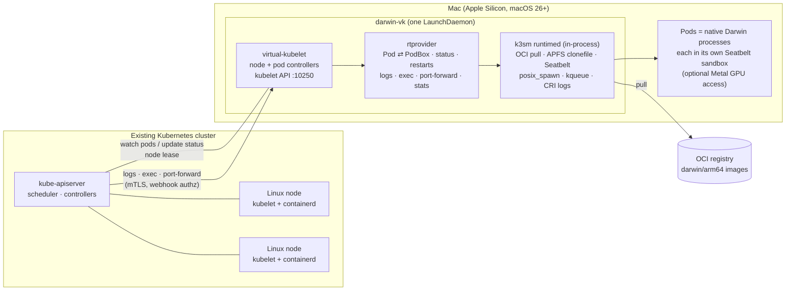

# darwin-runner-vkube

**Join a Mac to any Kubernetes cluster as a worker node, and schedule macOS workloads next to your Linux ones.**

`darwin-vk` is a [virtual-kubelet](https://github.com/virtual-kubelet/virtual-kubelet) node agent for macOS. It runs [k3sm](https://github.com/k3sm-io/k3sm)'s native runtime, [`runtimed`](https://github.com/k3sm-io/runtimed), inside the same process. Pods scheduled onto the Mac run as **native Darwin processes** confined by a per-pod Seatbelt sandbox. They can come from **OCI images** (`darwin/arm64`) and can get access to the Mac's **Metal GPU**. No Linux VM is involved.

## A heterogeneous cluster

Most clusters are all Linux. Some work only runs on macOS: Xcode builds and signing, iOS simulators, Metal/MLX inference on Apple Silicon unified memory, macOS-only tooling. `darwin-vk` lets those workloads join the cluster you already run, rather than needing a separate fleet with separate tooling:

- **One control plane, mixed OS and architecture.** Linux amd64/arm64 nodes and Apple Silicon Macs sit in the same cluster. The scheduler places pods by `kubernetes.io/os` / `kubernetes.io/arch`, so a single Deployment, Job or CI pipeline can fan out across both.
- **The same tools everywhere.** `kubectl`, Helm, GitOps, RBAC, Secrets, namespaces and quotas work the same for macOS workloads. `kubectl logs`, `exec`, `port-forward` and `top` work on Mac pods.
- **Opt-in placement.** The Mac node is tainted, so Linux workloads never land on it by accident. Linux DaemonSets (CNI, kube-proxy) stay away because of their `os=linux` selectors.
- **Apple Silicon GPU as a schedulable resource.** Pods that request `mlx.k3sm.io/gpu` get Metal access. All other pods are denied it by the sandbox.

## Architecture



| Kubernetes concept | On the Mac |
|---|---|
| Node | `kubernetes.io/os=darwin`, real CPU/memory capacity, tainted `virtual-kubelet.io/provider=darwin:NoSchedule` |
| Container image | A `darwin/arm64` OCI image pulled, digest-pinned and unpacked with APFS `clonefile`. Unsigned binaries are ad-hoc signed. Or `image: native` with an absolute host `command`. |
| Isolation | A generated default-deny Seatbelt profile per pod: the pod can write only its own data dir, the user's home is denied, and so are other pods. As root, pods also drop to a dedicated `_darwinvk` user. |
| GPU | The node advertises `mlx.k3sm.io/gpu` plus chip and memory labels. A pod that requests it gets Metal (AGX/IOSurface) access in its sandbox; other pods are denied. See [GPU pods](#gpu-pods). |
| `restartPolicy` | `Always` / `OnFailure` / `Never`, with CrashLoopBackOff (10s doubling to 5m) |
| Logs | CRI-format files; `kubectl logs` with `-f`, `--tail`, `--previous`, `--timestamps`, `--since` |
| `kubectl exec` | Re-enters the pod's sandbox and identity. TTY, stdin and exit codes are supported. |
| `kubectl port-forward` / `top` | Supported. `top` uses `proc_pid_rusage` accounting through `/metrics/resource`. |
| Pod IP | The node IP (host network) |
| Daemon restart | Running pods are re-attached rather than restarted |

## Status

The roadmap and design notes are in [issue #1](https://github.com/changtimwu/darwin-runner-vkube/issues/1).

| Phase | | |
|---|---|---|
| v0 | ✅ | Unconfined host-process provider (`--runtime=process`) |
| P0 | ✅ | Spike: runtimed in-process, OCI pull, GPU in sandbox ([findings](spike/p0/FINDINGS.md)) |
| P1 | ✅ | runtimed-backed provider: lifecycle, restarts, logs, exec, port-forward, stats, re-attach, LaunchDaemon |
| P2 | ⏳ | OCI polish: `imagePullSecrets`, HTTPS registries, signature policy, image GC |
| P3 | ✅ | GPU advertisement (`mlx.k3sm.io/gpu` capacity and labels), GPU memory admission, Xcode toolchain opt-in |
| P4 | ⏳ | Volumes, probes, memory limits / `OOMKilled` |
| P5 | ⏳ | Linux images through the `vm` RuntimeClass; routable pod networking and cluster DNS |

## Requirements

- An Apple Silicon Mac on **macOS 26 (Tahoe) or later**
- Go 1.26+ with cgo (Xcode Command Line Tools)
- Network reachability: the Mac to the API server, and the API server to the Mac on TCP **10250** (for logs, exec and port-forward)

## Quick start

**1. Build** (fetches the pinned `k3sm-io/runtimed` and `k3sm-io/apis` checkouts into `third_party/`):

```sh
make build        # -> bin/darwin-vk and bin/k3sm-execshim (must stay side by side)
make test
```

**2. On the cluster** (admin kubeconfig):

```sh
kubectl apply -f deploy/rbac.yaml
./deploy/make-kubeconfig.sh            # -> darwin-vk.kubeconfig, cluster-ca.crt
```

`--client-ca` must be the CA that signs the API server's **kubelet client** certificate. On kubeadm that's the cluster CA. On k3s it's `/var/lib/rancher/k3s/server/tls/client-ca.crt`.

**3a. Run for development** (as your user; pods share your uid but stay sandboxed):

```sh
./bin/darwin-vk --kubeconfig darwin-vk.kubeconfig --client-ca cluster-ca.crt --node-ip <mac-ip>
```

**3b. Install for production** (root LaunchDaemon; pods drop to the `_darwinvk` user):

```sh
sudo deploy/install.sh darwin-vk.kubeconfig cluster-ca.crt --node-ip <mac-ip>
sudo deploy/install.sh --uninstall
```

**4. Try it:**

```sh
kubectl get nodes -o wide
kubectl apply -f examples/hello.yaml
kubectl logs -f hello-mac
kubectl exec -it hello-mac -- /bin/zsh
```

To run your own image, build a `darwin/arm64` binary and package it as an OCI image. `spike/p0/testimage/mkimage` is a minimal example, and `examples/oci-gpu.yaml` shows a GPU pod.

### k3s clusters

- Start the k3s server with `--egress-selector-mode disabled`. Otherwise the API server sends kubelet traffic through the k3s agent tunnel, which `darwin-vk` doesn't speak, and `logs`/`exec` fail with 502.
- k3s verifies kubelet serving certificates. Issue `--tls-cert`/`--tls-key` signed by `/var/lib/rancher/k3s/server/tls/server-ca.{crt,key}`, with the Mac's IP in the SAN.

## GPU pods

At startup runtimed probes the GPU (it opens the Metal device and runs a kernel). If Metal works and the sandbox can grant it, the node advertises:

| | Example (M1 Max, 32 GB) | |
|---|---|---|
| `mlx.k3sm.io/gpu` (capacity) | `2` | GPU memory slots: one per 1.5 GiB of usable GPU memory, at least 1 and at most 2. Slots share one integrated GPU; they are not separate devices. |
| `mlx.k3sm.io/gpu.present` | `true` | For `nodeSelector` |
| `mlx.k3sm.io/chip` / `chip-family` | `apple-m1-max` / `m1` | Select an exact chip or a generation |
| `mlx.k3sm.io/memory-gb` | `32` | Unified memory in whole GiB |

These are the same keys and slot arithmetic [k3sm](https://github.com/k3sm-io/k3sm) uses, so a workload can target either kind of Mac node. Without a usable GPU, or with `--disable-gpu`, the node advertises none of them, and a restart removes them.

A GPU pod must set a memory limit on every container. The node adds up the limits of its running GPU pods and checks them against the GPU memory ceiling (the smaller of Metal's recommended working set and the iogpu wired limit):

- **No memory limit**, or **no GPU on this node**: the pod is `Failed` with reason `AdmissionRejected`, as the kubelet does on an admission failure.
- **Doesn't fit next to the running GPU pods**: the pod stays `Pending` (`ProviderFailed`) and starts once another GPU pod ends.

`examples/oci-gpu.yaml` runs the same Metal probe twice. The pod with the limit computes on the GPU and the pod without it gets no Metal device.

**Xcode toolchain:** the annotation `k3sm.io/xcode-toolchain: ""` gives a pod read access to the Xcode developer directory (`xcode-select -p`) for builds. It needs a full Xcode install. On a Command Line Tools-only Mac it grants nothing, because those tools are already readable.

## Flags

| Flag | Default | |
|---|---|---|
| `--runtime` | `runtimed` | `runtimed` (sandboxed, OCI, GPU) or `process` (v0: unconfined host processes) |
| `--kubeconfig` | `$KUBECONFIG` | Cluster credentials |
| `--nodename` | hostname | Node name |
| `--node-ip` | auto-detect | IP advertised for the node and its pods. Set this when the API server is reached through localhost or NAT. |
| `--client-ca` | | Enables mTLS and webhook authn/authz on the kubelet API |
| `--tls-cert` / `--tls-key` | self-signed | Kubelet API serving cert |
| `--insecure-no-auth` | false | Serves the kubelet API without auth. **Gives anyone who can reach the port shell access to the Mac.** |
| `--data-dir` | `~/.darwin-vk`, or `/var/lib/darwin-vk` as root | Image cache, pod dirs, logs |
| `--pod-user` | `_darwinvk` | As root, the identity pods without a securityContext run as |
| `--allow-root-pods` | false | As root, allow pods to run as root (still sandboxed) |
| `--signature-policy` | `adhoc-ok` | `adhoc-ok`, `require-signed` or `require-notarized` |
| `--max-pods` | 20 | Advertised pod capacity |
| `--disable-gpu` | false | Don't advertise the GPU, and reject pods that request it |
| `--taint` | true | Add the NoSchedule taint |

If neither `--client-ca` nor `--insecure-no-auth` is set, the kubelet API stays off. Pods still run, but `logs`, `exec` and `port-forward` are unavailable.

## Limitations

- **Host networking.** The pod IP is the node IP, so two pods binding the same port conflict. Cluster DNS and ClusterIP Services aren't reachable from Mac pods yet (P5).
- **macOS images only.** Linux images need the `vm` RuntimeClass (P5).
- **One trust domain per node.** Seatbelt limits what a pod can reach on the filesystem, but there are no separate network namespaces. Don't run mutually untrusted tenants on one Mac.
- **Upgrades restart pods.** runtimed only re-attaches processes spawned by the same binary, so a new `darwin-vk` build restarts every pod.
- Seatbelt is private Apple SPI, and runtimed carries a symbol canary for it. A macOS update could break it.

## Credits

The pod runtime is [k3sm-io/runtimed](https://github.com/k3sm-io/runtimed) with its contracts in [k3sm-io/apis](https://github.com/k3sm-io/apis), both Apache-2.0 by the k3sm Authors. The node machinery is [virtual-kubelet](https://github.com/virtual-kubelet/virtual-kubelet).
